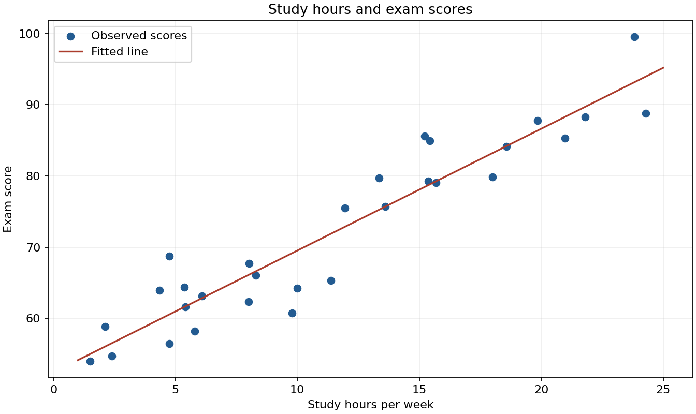

# Session 3 · Pickling a Python Model

This exercise saves Python containers, a custom grade tracker, and a scikit-learn linear regression model, then loads them in a fresh Python process. The regression uses 30 synthetic examples of weekly study hours and exam scores. [Course exercise](https://gitee.com/lundechen/data_engineering_master_2026_fall/blob/master/session-3/practice-pickling-of-a-model.md)

## Run the exercise

Use Python 3.12 and install the versions used to generate the submitted files.

```bash
python -m pip install -r requirements.txt
python pickling_demo.py save --output-dir rebuilt
python pickling_demo.py load --output-dir rebuilt
```

The `save` command generates the examples, fits the regression, and writes both model formats and the plot. The `load` command reloads the objects, adds three grades to the tracker, saves the updated tracker, and checks that the two model formats give identical predictions for the same six inputs. Omit `--output-dir` to use `artifacts/`.

## Submitted files

| Files in `artifacts/` | Contents |
| --- | --- |
| `fruits.pkl`, `scores.pkl`, `complex_data.pkl` | List, dictionary, and nested data |
| `ml_course_grades.pkl`, `ml_course_grades_updated.pkl` | Grade tracker before and after adding three grades |
| `study_hours_model.pkl`, `study_hours_model.joblib` | The fitted linear regression in two formats |
| `study_hours_model.png` | Scatter plot and fitted line |

`GradeTracker` lives in the importable `grade_tracker.py` module so a later Python process can resolve its class during unpickling. Load pickle and joblib files from trusted sources. [scikit-learn model persistence](https://scikit-learn.org/stable/model_persistence.html)


